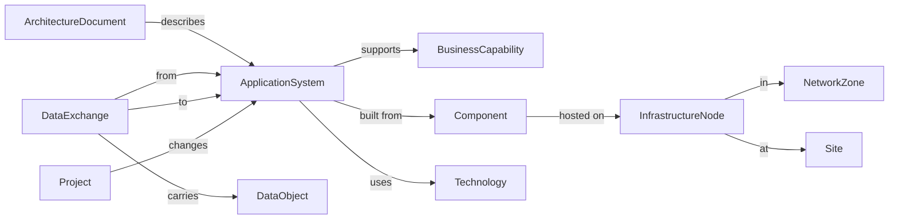

# Graph-RAG enterprise architecture agent

[](https://github.com/acceliance)
[](LICENSE)
[](https://github.com/acceliance/Graph-Rag-Enterprise-Archicturecture/commits/main)
[](https://hub.docker.com/repositories/acceliance)
[](https://neo4j.com/)
[](https://qdrant.tech/)
[](https://www.modelio.org/)

> **First time here?** Follow the [**tutorial**](docs/tutorial/README.md): seven illustrated steps, from starting the stack to asking the *Enterprise Architect* agent about the two sample architecture documents.
>
> **New to the application?** Start with the [**User manual**](https://github.com/acceliance/Graph-Rag-Deploy/blob/main/USER-MANUAL.md): it walks through every screen of the web application, from asking questions to profiles and prompts, once the stack is running.

Ask questions about an IT department's architecture documents and get answers from a **typed knowledge graph**. The PDFs (enterprise architecture blueprints, technical architecture documents, system design documents, interface control documents, IT master plans) are read by [Acceliance Graph-RAG](https://github.com/acceliance/Graph-Rag-Deploy), which extracts the systems, the exchanges between them, the infrastructure they run on and the business capabilities they support into **Neo4j**, keeps the evidence (chunks and pages) in **Qdrant**, and answers through a web agent, a REST API and an **MCP** endpoint for external AI hosts.

This repository holds everything to run that agent for enterprise architecture: the data model, the Modelio project that governs it, sample documents, and the Docker deployment kit.

## What you can ask

- Which systems exchange data with SAP S/4HANA Finance, and over which protocol?
- Which components of a system run on Oracle, and on which infrastructure?
- Which servers, network zones and sites host a system?
- Which business capabilities does an application support, and in which business area?
- Which systems are legacy or planned for replacement, and by which project?
- Which documents describe the same system, and how did it change between editions?

## What is in this repository

| Folder | Content |
|---|---|
| [`model/`](model/README.md) | The enterprise architecture data model, [`enterprise-architecture-model.json`](model/enterprise-architecture-model.json): 19 classes, 15 enumerations, 46 relations in six domains (business, application, integration, infrastructure, technology, governance), plus the **Modelio project** that governs it |
| [`samples/`](samples/README.md) | [`source-docs/`](samples/source-docs/): two architecture PDFs of a fictive enterprise, Orvanne Group, whose information system has two main blocks, SAP S/4HANA Finance for accounting and the Salesforce Order Platform for order management (satellite applications, data exchanges, infrastructure, technology standards, decisions, projects); [`src/`](samples/src/): their Markdown sources and the script that builds the PDFs; [`profiles/`](samples/profiles/): the *Enterprise Architect* agent profile that infers the landscape from them |
| [`schemas/`](schemas/README.md) | JSON Schemas for the model, the ingestion ledger and the prompt files |
| [`modelio/`](modelio/) | The GraphRag module for Modelio (`GraphRag_5.4.01.jmdac`) that declares the Graph-RAG stereotypes |
| [`DEPLOY.md`](DEPLOY.md) | The full deployment guide: sizing, HTTPS, AI provider settings, backup, upgrade, troubleshooting |
| [`docs/`](docs/) | The [tutorial](docs/tutorial/README.md) and the [AI model recommendations](docs/ai-model-recommendations.md): OpenAI and Anthropic models benchmarked on an earlier corpus of public architecture documents for extraction quality and token cost |

## Quick start

The product runs from two images, `acceliance/graphrag-api` and `acceliance/graphrag-web`, published on the [Acceliance Docker Hub organisation](https://hub.docker.com/repositories/acceliance); the Compose file pulls them, nothing is built here. You need Docker Desktop (Windows, macOS), Docker Engine 24+ with Compose v2, or on Windows WSL 3.0.1+ with its built-in `wslc` container CLI (below), and an AI provider key for the chat, extraction and embedding roles (entered in the application, never in a file).

```powershell
.\scripts\up.ps1        # Windows
```

```bash
scripts/up.sh           # Linux, macOS
```

The script creates `.env` with generated secrets, pulls the images, starts the stack and prints the URL, `http://localhost:8080` by default. Then:

1. Create the administrator account on the first visit.
2. Enter your AI provider settings under **Admin ▸ AI settings**. For the models to choose, see the [AI model recommendations](docs/ai-model-recommendations.md). As of October 2026: `gpt-5.6-luna` for extraction (about $0.0015 per page), `claude-haiku-5-5` for the agent (about $0.01 per question).
3. On the **Model** screen, upload [`model/enterprise-architecture-model.json`](model/enterprise-architecture-model.json), then *Validate* and *Initialise*.
4. Upload the PDFs from [`samples/source-docs/`](samples/source-docs/) (or your own).
5. On the **Profiles** screen, click **New profile**, name it `enterprise-architect` and paste [`samples/profiles/enterprise-architect.md`](samples/profiles/enterprise-architect.md); then select it on the **Agent** screen and ask questions.

The same steps, with a screenshot of each screen, are in the [tutorial](docs/tutorial/README.md).

For a pilot over plain HTTP set `AUTH_COOKIE_SECURE=false` in `.env`; production needs HTTPS through a reverse proxy. See [`DEPLOY.md`](DEPLOY.md).

### Windows without Docker Desktop: WSL containers (`wslc`)

WSL 3.0.1 and later run Linux containers natively with the `wslc` command, so you don't need Docker Desktop. In an administrator PowerShell, install or update WSL and check the version:

```powershell
wsl --install --no-distribution
```

```powershell
wsl --update
```

```powershell
wsl --version
```

```powershell
wslc version
```

`wsl --install` is needed only when WSL is not installed yet (restart Windows afterwards). `wsl --version` must show 3.0.1 or later. Then, from the repository folder, start the server:

```powershell
.\scripts\wslc.ps1
```

`wslc` has no Compose support yet, so this script starts the four containers of [`docker-compose.yaml`](docker-compose.yaml) one by one with `wslc container run`, with the same images, secrets and volumes. Stop them with `.\scripts\wslc.ps1 Stop`; pull newer images with `.\scripts\wslc.ps1 Update`. The full procedure (memory settings, proxy, the individual `wslc` commands, differences from Compose) is in [`DEPLOY.md` §2a](DEPLOY.md#2a-windows-without-docker-desktop-wsl-containers-wslc).

## The model

Every extracted fact fits one of nineteen classes. Three anchor the relevance gate: `ArchitectureDocument` (each PDF is one), `ApplicationSystem` and `DataExchange`.



The complete class diagram, the design decisions and the extraction rules are in [`model/README.md`](model/README.md). The model is designed in **Modelio**, and the Modelio project is the reference: change the model there, export it, validate it, then upload it. The process is described in the *Modelio project* section of that file.

## Sample documents

[`samples/source-docs/`](samples/source-docs/) holds two architecture documents of a fictive enterprise, Orvanne Group, a distributor of heating and ventilation equipment. Its information system has two main blocks: **SAP S/4HANA Finance** for accounting and the **Salesforce Order Platform** for order management. Each document presents one block: its components, its satellite applications, the data exchanges (with field-level layouts for some), the infrastructure, the technology standards, the quality requirements, the architecture decisions and the projects. The exchanges between the two blocks are described in both documents. [`samples/README.md`](samples/README.md) describes the documents and what they are built to test.

[`samples/profiles/enterprise-architect.md`](samples/profiles/enterprise-architect.md) is the agent profile for this corpus: it reasons along the model's relations, consolidates what both documents say about the same system or exchange, reports the points where they disagree, reports undocumented systems as gaps, and labels every inference with the cited facts it rests on. Its body lists questions to try, layer by layer.

The enterprise is invented; the software products it uses are real and are named only to make the landscape realistic (see [the rights notes](samples/README.md#rights-and-usage)). Before publishing this repository, see the *Modelio* notes in the model README about the size of the Modelio project.

## Duplicates and false positives

The two sample documents describe one IT system, so most artefacts appear in both: the same
exchange, system, site or project is extracted twice and must become one node. Some of that is
by design (a component described in two documents is one node per owner; a system cited by a
shorter name is a stub until a review merges it). What goes wrong is **false positives**:
pairs of different artefacts on the *Review* screen ("Lead Management" and "Credit
Management", "RAML" and "SAML") or merged automatically.

### What to expect on the samples

- **Merged by themselves**: the eight `O2C` exchanges, the systems and sites both documents name,
  and the projects written once with and once without "project" ("Horizon O2C" and "Horizon O2C
  project"; the other spelling is kept as an alias).
- **Proposed on *Review***: a name that is the beginning of another ("SAP" and "SAP SE", "Adyen"
  and "Adyen Payments", "OData" and "OData V4"). Merge the genuine ones, dismiss the others
  ("Supplier" and "Supplier Invoice" are two data objects).
- **Left as duplicates, by the model's settings**: `DataExchange`, `InfrastructureNode`,
  `NetworkZone`, `ArchitectureDocument` and `ArchitecturePrinciple` match **exactly**, so an
  exchange cited by its identifier alone ("FIN-10") stays next to the full name, and a catalogue
  row listing three servers ("s4p-app-01, s4p-app-02, s4p-app-03") stays next to the three
  single servers.
- **Planted contradiction**: `O2C-02 Customer Credit Status` runs every 15 minutes in the SAP
  document and every hour in the Salesforce one. The graph keeps one value, the one of the
  document written last; the other stays in that document's text. Ask the agent for both
  citations, or read both pages through *Documents*.

### Tuning for this model

| Symptom | Setting to change (in Modelio, then *Model ▸ Upgrade*) |
|---|---|
| Wrong pairs on *Review* for a class | Raise `graphRagReviewBand` of that class (0.85 keeps near-identical names) |
| Wrong automatic merges | Raise `graphRagFuzzyThreshold` of that class |
| An identifier cited alone next to the full exchange name | Add to the extraction hints of `DataExchange`: "always the identifier followed by the title, as printed in the catalogue" |
| Several servers extracted as one node | Add to the hints of `InfrastructureNode`: "one node per host name, never a list of hosts" |
| An exchange stored as a business capability, a satellite application stored as a technology | Tighten the hints of both classes, and try a stronger model in *Admin ▸ AI settings ▸ Extraction* |
| Real duplicates never proposed | Lower the review band, or switch the class from `exact` to `fuzzy` if its names are free text |

The matching rules, the scoring and the limits are explained in the
[application README](../graph-rag-application/README.md#entity-matching-duplicates-and-false-positives)
and in the *Duplicates and false positives* section of the deployment kit's README. After a
product update, replay the stored extractions with *About ▸ Rebuild* (*reuse extraction*, no
LLM cost): it wipes the graph, including review decisions.

## Licence

The files of this repository (Compose file, scripts, schemas, model, documentation) are under the [Apache License 2.0](LICENSE). The product images ([Docker Hub](https://hub.docker.com/repositories/acceliance)) are free of use under their own licence, described in [`LICENSE-IMAGES.md`](LICENSE-IMAGES.md). The sample documents were written for this repository and are covered by the same licence: see [`samples/README.md`](samples/README.md#rights-and-usage).
